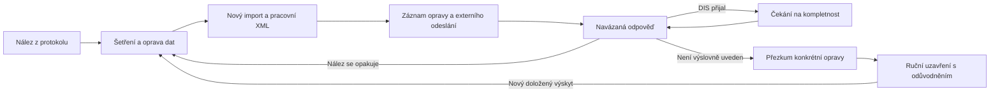

# Sledování nálezů, oprav a navazujících odpovědí

Volba **Chyby a opravy…** sleduje nálezy jedné organizace a jednoho období přes
více importů a odpovědí. Každý nález má původní protokol, popis, stav a neměnnou
historii událostí. Jeden záznam opravy může řešit více nálezů najednou.

Opravu proveďte standardní obsluhou mzdového systému nebo v potvrzeném mapování
a načtěte nový CSV/XLSX / pracovní XML. Evidence nemění databázi ani výpočetní
jádro mzdového systému, nedoplňuje neznámé mzdy a sama nevytváří opravné podání.
**Finální export zůstává blokovaný.** Interní číslo opravy není oficiální typ
podání, technické ID zprávy ani GUID měsíčního hlášení.

## Pracovní postup

1. Načtěte protokol přes **Protokoly ČSSZ…**. Strukturované chyby se zaregistrují
   automaticky. Dříve uložené protokoly se při otevření přehledu doplní bez
   změny jejich originálů. DIS chybu bez určené části lze evidovat jako nález
   celkové zprávy k ručnímu přezkumu. PDF/nerozpoznané XML se automaticky nerozebírá.
2. V **Chyby a opravy…** prohlédněte kód, část, PP, popis a historii. Přes
   **Poznámka k šetření…** zaznamenejte zjištění bez změny stavu. Chybějící PP
   se neodvozuje ze jména ani z volného textu chyby.
3. Vyberte jeden nebo více nálezů a **Zapsat připravenou opravu…**. Zvolte
   správný opravený import a jeho XML, popište konkrétní opravu a potvrďte návaznost.
   Původní import a XML zůstávají dostupné. Lze evidovat i opakované zpracování
   stejných dat například po externím vyřešení registrace; záznam sám netvrdí,
   že se částky změnily nebo že je oprava metodicky správná.
4. Pokud bylo podání skutečně odesláno mimo aplikaci, použijte **Zaznamenat
   externí odeslání…**. Pro DIS zadejte přesné vlastní ID zprávy, pro cJMHZ
   přesné ID konkrétního podání. Nezadávejte místo něj GUID měsíčního hlášení.
   Záznam není doklad o doručení a nic neodesílá.
5. Načtěte novou odpověď k opravenému importu a XML. Předem evidované ID,
   organizace, období a konkrétní XML umožní automatické navázání na opravu.
   Chybné/nejednoznačné reference se neodhadují. Pokud se ID doplnilo až po
   importu nebo není známé, vyberte opravu a **Navázat již načtenou odpověď…**
   s výslovným potvrzením a zdůvodněním návaznosti.
6. Není-li jednoznačné přiřazení konkrétní chyby, použijte **Ruční spárování
   výskytu…**: zvolte nález, opravu, navázanou odpověď a konkrétní výskyt. Vyžaduje
   shodný typ protokolu a chybový kód i odůvodnění. Původní pozorování se nemaže;
   propojený další výskyt lze zobrazit volbou nad tabulkou. Dvě již rozpracované
   historie se automaticky neslučují.
7. **Uzavřít po přezkumu…** vyžaduje poslední opravu, její navázaný protokol
   o kompletnosti, popis konkrétního ověření a výslovné potvrzení. Výsledek je
   označen **Uzavřeno ručním přezkumem**, nikoliv „úřadem automaticky schváleno“.
   Pokud se nález výslovně opakuje, uzavření se odmítne. DIS přijetí ani samotné
   zmizení ze seznamu k uzavření nestačí. Nález lze znovu otevřít s důvodem.

## Párování a stavy

Jednoznačný opakovaný nález vyžaduje stejný druh protokolu, explicitní chybový
kód, případně typ chyby a doložený formulář/PP či souhrnnou část. Popis se
nepoužívá jako párovací klíč. Technické části DIS a stav MH z cJMHZ se neslévají.
Známé starší i novější GUID téhož opraveného PP se zachovají: chyba vrácená pod
původním GUID se nesmí ztratit jen kvůli novému GUID v opravených datech.

PP se navazuje přes jeho přesné interní číslo v organizaci a identifikátory
skutečně obsažené v XML. Rozpor známých identifikačních údajů návaznost blokuje;
není řešen odhadem. Ručně doložené přiřazení původně neurčeného nálezu zůstává
v historii a může být podkladem další opravy.

| Stav | Co skutečně znamená |
| --- | --- |
| Otevřeno | Protokol obsahuje nález k řešení. |
| Oprava připravena | Uživatel zaznamenal postup a vybral import/XML. |
| Čeká na odpověď | Je evidováno uživatelem potvrzené externí odeslání. |
| Nález se opakuje | Navázaná odpověď výslovně obsahuje stejný doložený problém. |
| DIS přijal – čeká na kompletnost | Doložená část prošla DIS, celkové vyhodnocení tím není potvrzené. |
| Nutný přezkum | Nález chybí, rozsah není jednoznačný nebo si odpovědi odporují. |
| Uzavřeno ručním přezkumem | Uživatel výslovně ověřil konkrétní opravu a zdokumentoval důvod. |

Starší odpověď k předchozí opravě nezmění novější rozpracovaný stav. U cJMHZ
se porovnají skutečné časové údaje protokolu včetně timezone; shodné nebo
neporovnatelné časy s rozdílným obsahem vyžadují přezkum. Pozdě načtený DIS
nepřebije navázané cJMHZ. Opakované odlišné DIS odpovědi bez doloženého pořadí
se nevyhodnotí stylem „poslední import vyhrává“. Nový výslovný výskyt může znovu
otevřít i nález dříve uzavřený ručním přezkumem. Starší odpověď bez chyby nesmí
zakrýt novější opakovaný nález.

## Historie a hranice

Evidence je lokální a neměnná: nálezy, opravy, uživatelská potvrzení externího
odeslání, návaznosti odpovědí a stavové události jsou v DB příslušné organizace.
Záloha/obnova zachovává celou návaznost. Stejné protokoly a reference se tiše
nepřepisují; nová oprava má vlastní interní pořadí od nuly pro organizaci/měsíc.
Nejde o oficiální pořadí verzí JMHZ. Při podezření na chybný záznam přidejte
zdůvodněnou poznámku a proveďte přezkum, nikoliv ruční úpravy SQLite.

Samotné načtení protokolu, shoda ID ani ruční uzavření nepotvrzují pravost
podpisu, celkovou metodickou správnost nebo připravenost k podání. Rozpoznané
stavy cJMHZ a chybějící podklady jsou uvedené v [návodu protokolů](cssz-receipts.md).
Šifrování zatím není implementované: poznámky mohou obsahovat osobní/mzdové
údaje, patří pouze do soukromého UI a organizační DB, nikoliv do běžných logů.
Převodní jádro, CSV Windows-1250, přesné součty, HPP/DPČ/DPP i více organizací
zůstávají zachované. Pro novou funkci je po sloučení potřeba nové EXE.

## Ověření 19. 11. 2026

Prošlo 306 testů celé moderní sady a 224 testů kompatibilní sady jádra/Qt5.
Patnáct testů evidence oprav ověřuje opakování nálezů, více oprav, přesné
reference, ruční vazby, historické odpovědi, rozdílné PP, izolaci organizací,
malé okno GUI a obnovu ze zálohy. Vše proběhlo na Linuxu s Pythonem 3.12.14 /
PySide6 6.12.0 a Pythonem 3.8.20 / PySide2 5.15.2.1. Syntetický self-test
distribuce nyní kontroluje také tento cyklus. Windows EXE této etapy nebylo
sestavené ani otestované na cílových Windows.
